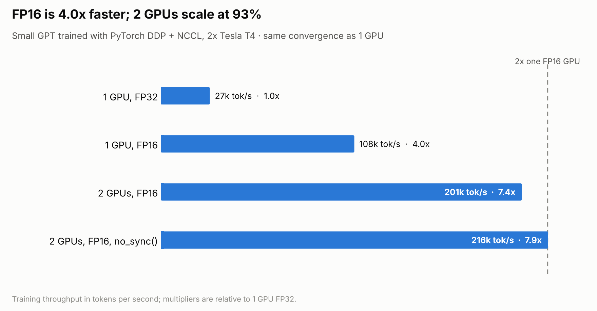

# Distributed Training with PyTorch DDP

A small GPT-style language model trained on one GPU and then two with PyTorch DistributedDataParallel. The same questions I work on in MPI codes, applied to AI training: how much does communication cost, and how close to linear does it scale?

Status: done on 2x Tesla T4 (Kaggle). FP16 is 4.0x faster than FP32; 2 GPUs scale at 93%, or about 100% with gradient accumulation and `no_sync()`; 2-GPU training converges like 1-GPU training; one oversized DDP bucket costs 9% by killing compute/communication overlap.

## Setup

- **Model** ([`model.py`](model.py)): decoder-only transformer written from scratch. 6 layers, 8 heads, width 512, context 256 tokens, pre-norm blocks, tied input/output embeddings, PyTorch `scaled_dot_product_attention`. **19.2M parameters, about 125 MFLOPs per training token.**
- **Data** ([`data.py`](data.py)): byte-level (vocabulary of 256 byte values, no tokenizer), Tiny Shakespeare by default (1.1 MB, public domain), 90/10 train/validation split. Each GPU samples random windows with its own seed, so no sampler or sharding is needed.
- **Training** ([`train.py`](train.py)): AdamW, linear warm-up then cosine decay, gradient clipping. One script for one GPU (`python train.py`) and several (`torchrun --nproc_per_node=N train.py`). Options for FP16 mixed precision (`--amp fp16`), gradient accumulation with or without `no_sync()`, DDP bucket size, and a `torch.profiler` trace.
- **Metrics**: throughput in tokens/s, measured after 20 warm-up steps with evaluation time excluded; MFU (model FLOPs utilization) against the T4's dense peak (8.1 TFLOPS FP32, 65 TFLOPS FP16); peak GPU memory; training and validation loss curves. Each run writes a JSON file; [`summarize.py`](summarize.py) turns them into a table.

## Experiments

| # | Question | Runs |
|---|---|---|
| 1 | Single-GPU baseline | 1 GPU, FP32 |
| 2 | What does mixed precision buy on the T4's Tensor Cores? | 1 GPU, FP16 |
| 3 | How well does throughput scale to 2 GPUs? | 2 GPUs, FP16, same per-GPU batch as run 2 → scaling efficiency |
| 4 | Does 2-GPU training converge like 1-GPU training? | 1 GPU with 2 accumulation steps vs 2 GPUs, same global batch → compare loss curves |
| 5 | What does communication cost, and can it be hidden? | 2 GPUs with gradient accumulation, with and without `no_sync()`; different bucket sizes; profiler trace |

Scaling efficiency = tokens/s on N GPUs ÷ (N × tokens/s on 1 GPU).

## Checks done before the GPU runs

- Model: 19.2M parameters as designed; initial loss 5.57, matching ln(256) = 5.55 for a uniform guess over 256 bytes; a tiny configuration learns a repetitive text (loss 5.57 → 0.23 in 60 CPU steps).
- Found and fixed a bug that would have stopped the first GPU step: the target tensor is a strided slice, so `view()` failed; it now uses `reshape()`.
- DDP logic with 2 CPU processes (`torchrun`, gloo backend): 1 process with 2 accumulation steps and 2 processes with 1 step, i.e. the same global batch, reached the same validation loss (4.173 vs 4.171) after 40 steps. The `no_sync()` path and small buckets also ran. The script falls back to CPU only for such logic checks; CPU numbers are not measurements.

## Results

2x Tesla T4 on Kaggle, PyTorch 2.11 (CUDA 13.0), 300 steps per run. Raw data: [`results/kaggle-t4x2.csv`](results/kaggle-t4x2.csv).



Regenerate the chart with `python scripts/plot_results.py` (requires matplotlib).

| Run | Purpose | GPUs | Precision | Global batch (tokens) | tokens/s | ms/step | MFU | Peak memory | Final val loss |
|---|---|---|---|---|---|---|---|---|---|
| 1 GPU FP32 | baseline | 1 | FP32 | 8,192 | 27,120 | 302.1 | 41.7% of 8.1 TFLOPS | 1.98 GB | 2.047 |
| 1 GPU FP16 | speed reference for scaling (same per-GPU batch as 2 GPUs) | 1 | FP16 AMP | 8,192 | 107,597 | 76.1 | 20.6% of 65 TFLOPS | 1.29 GB | 2.048 |
| **2 GPUs FP16** | scaling and convergence | 2 | FP16 AMP | 16,384 | **200,867** | 81.6 | 19.2% | 1.37 GB | **1.898** |
| 1 GPU FP16, 2 accumulation steps | convergence reference (same global batch as 2 GPUs) | 1 | FP16 AMP | 16,384 | 96,789 | 169.3 | 18.5% | 1.37 GB | **1.895** |

**1. Mixed precision: 4.0x faster, 35% less memory, same loss.** FP16 autocast moves the matrix multiplies onto the T4's Tensor Cores: 27,120 → 107,597 tokens/s, peak memory 1.98 → 1.29 GB, and the final validation loss is unchanged (2.047 vs 2.048).

**2. MFU tells a different story than speed.** FP32 uses 41.7% of the 8.1 TFLOPS FP32 peak. The SGEMM project showed that the T4 sustains only about 4.1 TFLOPS in FP32 under load, so the training loop runs at roughly 80% of what cuBLAS reaches. FP16 uses only 20.6% of the 65 TFLOPS Tensor Core peak: once the matrix multiplies are 8x faster, the parts that did not speed up (LayerNorm, softmax, GELU, the optimizer step, Python and data sampling) take a much larger share of each step. This is where fused kernels like the ones in project 2 pay off.

**3. Two GPUs scale at 93%.** With the same per-GPU batch, 2 GPUs process 200,867 tokens/s versus 2 x 107,597 = 215,194 for perfect scaling. Each step takes 81.6 ms instead of 76.1 ms; the 5.5 ms difference is mostly the all-reduce of 19.2M FP32 gradients (77 MB) between the two T4s, which are connected over PCIe without NVLink. DDP already overlaps most of that transfer with the backward pass by sending gradients in buckets while later layers are still computing.

**4. Two GPUs converge like one.** At the same global batch of 16,384 tokens, 2-GPU DDP reached a final validation loss of 1.898 and 1 GPU with 2 accumulation steps reached 1.895, within run-to-run noise. Data parallelism changed the speed, not the result. (Both are lower than the 8,192-token runs simply because they saw twice as many tokens in 300 steps.)

Measurement caveat: the runs were executed one after another on the same notebook. The accumulation run, which came last, is about 10% slower per micro-step than the earlier FP16 run, although it does the same work per micro-step and fewer optimizer steps. The likely cause is the T4 lowering its clock as it heats up, as measured in the SGEMM project. That means later runs, including the 2-GPU run, may be slightly penalized, and the 93% scaling efficiency is, if anything, a conservative estimate.

### Communication (experiment 5)

All runs: 2 GPUs, FP16, 150 steps.

| Run | Global batch (tokens) | tokens/s | per GPU | ms/step | Final val loss |
|---|---|---|---|---|---|
| 4 accumulation steps, `no_sync()` (all-reduce once per step) | 65,536 | **215,581** | 107,791 | 304.0 | 2.188 |
| 4 accumulation steps, all-reduce every micro-step | 65,536 | 194,250 | 97,125 | 337.4 | 2.191 |
| Bucket 1 MB | 16,384 | 199,002 | 99,501 | 82.3 | 2.309 |
| Bucket 25 MB (default; 300-step run above) | 16,384 | 200,867 | 100,434 | 81.6 | — |
| Bucket 100 MB (one bucket for all 77 MB of gradients) | 16,384 | 183,284 | 91,642 | 89.4 | 2.309 |

**`no_sync()` is worth 11%, and makes scaling effectively perfect.** With 4 accumulation steps, skipping the all-reduce on the first three micro-steps raises throughput from 194,250 to 215,581 tokens/s; each avoided all-reduce saved about 11 ms. At 107,791 tokens/s per GPU, the `no_sync()` run matches the single-GPU speed (107,597): communication once per 4 micro-steps is fully amortized, i.e. about 100% scaling efficiency. Both runs reach the same loss (2.188 vs 2.191), so the saving is free.

**One big bucket costs 9%.** DDP sends gradients in buckets so that the all-reduce of the last layers' gradients runs while the backward pass is still computing earlier layers. With a 100 MB bucket, all 77 MB of gradients form a single bucket, so communication can start only after the whole backward pass: each step takes 89.4 ms instead of 81.6 ms. Very small 1 MB buckets were close to the default (199,002 vs 200,867 tokens/s, within run-to-run noise); on this PCIe pair, per-message overhead matters much less than losing overlap. Loss is identical across bucket sizes (2.309 vs 2.309), as it should be.

**Profiler: where a 2-GPU step goes.** From the `torch.profiler` trace (4 steps, FP16, about 85 ms per step with profiling on):

| Per step, per GPU | Time | Share of step |
|---|---|---|
| Matrix multiplies (Tensor Core GEMMs, forward and backward) | ~40 ms | ~47% |
| NCCL all-reduce of gradients (about 4 buckets) | ~14 ms | ~16%, mostly overlapped with backward |
| Everything else: LayerNorm, softmax, GELU, attention, optimizer, data loading, idle gaps | ~31 ms | ~37% |

The all-reduce kernels add up to about 14 ms per step, yet a 2-GPU step is only about 5.5 ms slower than a 1-GPU step, so roughly 60% of the communication is hidden behind the backward pass. And less than half of each step is spent in the matrix multiplies the MFU figure counts, which is why FP16 MFU is about 20%.

Comparisons are within this table; loss values depend on the number of steps and the global batch, so they are only comparable within each pair.

## Run

On Kaggle, set the accelerator to **GPU T4 x2** and enable internet (the corpus is downloaded on first use).

```bash
python train.py --amp none --out results/1gpu_fp32.json
python train.py --amp fp16 --out results/1gpu_fp16.json
torchrun --nproc_per_node=2 train.py --amp fp16 --out results/2gpu_fp16.json
python train.py --amp fp16 --grad-accum 2 --out results/1gpu_fp16_accum2.json
# experiment 5
torchrun --nproc_per_node=2 train.py --amp fp16 --grad-accum 4 --steps 150 --out results/2gpu_accum4_nosync.json
torchrun --nproc_per_node=2 train.py --amp fp16 --grad-accum 4 --steps 150 --sync-every-micro-step --out results/2gpu_accum4_sync.json
torchrun --nproc_per_node=2 train.py --amp fp16 --steps 150 --bucket-cap-mb 1 --out results/2gpu_bucket1.json
torchrun --nproc_per_node=2 train.py --amp fp16 --steps 150 --bucket-cap-mb 100 --out results/2gpu_bucket100.json
torchrun --nproc_per_node=2 train.py --amp fp16 --steps 40 --profile
python summarize.py results/*.json
```
