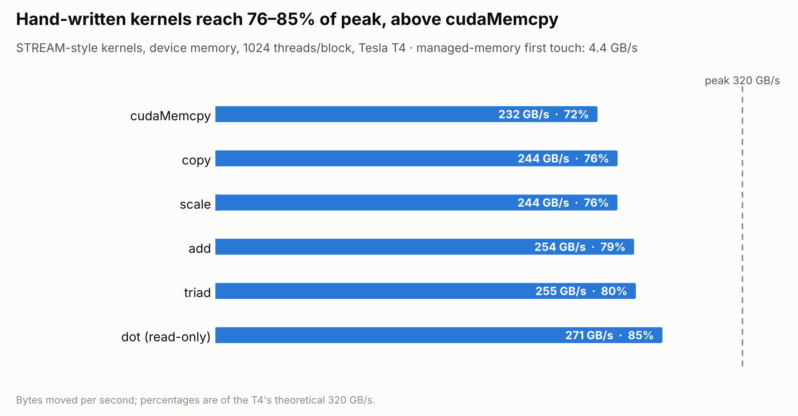

# Memory Bandwidth Benchmarking (STREAM-style)

How much of the hardware's memory bandwidth can code actually reach, and what decides it? Measured with STREAM-style kernels written from scratch: GPU first (Tesla T4), then CPU.

Status: done. GPU measured on a Tesla T4, CPU on a Kaggle VM; all results verified.

## GPU: `gpu_stream`

[`gpu_stream.cu`](gpu_stream.cu) runs five kernels on three arrays of doubles, 268 MB each (2^25 elements, as in BabelStream's default), the same kernels STREAM and BabelStream use:

| Kernel | Operation | Bytes moved per element |
|---|---|---|
| Copy | `c = a` | 16 |
| Mul | `b = s * c` | 16 |
| Add | `c = a + b` | 24 |
| Triad | `a = b + s * c` | 24 |
| Dot | `sum += a * b` | 16 |

It sweeps two things:

- **Thread-block size:** 64, 128, 256, 512, 1024 threads.
- **Where the arrays live:**
  - `device`: `cudaMalloc`, GPU memory.
  - `managed`: `cudaMallocManaged`, written first by the CPU. The first kernel has to migrate the pages to the GPU; that run is reported separately as `first_touch_copy`, later runs use GPU-resident pages.
  - `host`: pinned host memory mapped into the GPU (zero-copy), so every access crosses PCIe.

Every result is compared with the **theoretical peak**, computed from the memory clock and bus width the device reports (320 GB/s on a T4), and with **`cudaMemcpy`**, the baseline project 2 used. That closes a question project 2 left open: PyTorch's softmax ran at 242–244 GB/s, faster than `cudaMemcpy`'s 232 GB/s, so the copy was not the true ceiling.

Before timing, each configuration runs every kernel once from known values and checks the results (expected values are computed in the kernels' order with a 1e-12 relative tolerance, since 0.4 × 0.1 is not exactly 0.04 in binary and the GPU may fuse multiply-adds). Times are medians of batches after a GPU warm-up, the method used in the other projects.

## Predictions, written before measuring

- **Device memory:** Copy and Triad close to `cudaMemcpy` (about 230 GB/s, 72% of peak) or slightly above it, as PyTorch's softmax was. Add and Triad (two reads, one write) may edge out Copy and Mul.
- **Block size:** flat from 128 to 1024. Even 64 should reach full occupancy, since a Turing SM holds up to 16 blocks, 16 x 64 = 1,024 threads. Dot, with its fixed 1,024-block grid and block-level reduction, is most likely to be slower at small sizes.
- **Managed memory:** once the pages are on the GPU, the same as device memory. The first touch should be several times slower: the pages move over PCIe through page faults.
- **Mapped host memory:** limited by PCIe 3.0 x16, about 12 GB/s, roughly 4% of the GPU's peak.

## GPU results (Tesla T4)

Theoretical peak 320.1 GB/s (from the reported memory clock and bus width). Raw data: [`results/kaggle-t4.csv`](results/kaggle-t4.csv). Block size made almost no difference (next section), so this table shows the 1,024-thread runs.



Regenerate the chart with `python scripts/plot_results.py` (requires matplotlib).

| Kernel | Device memory | Managed (pages on GPU) | Mapped host memory |
|---|---|---|---|
| `cudaMemcpy` | 232.0 GB/s (72.5%) | — | — |
| Copy | 244.2 GB/s (76.3%) | 243.9 GB/s | 20.8 GB/s (6.5%) |
| Mul | 244.1 GB/s (76.3%) | 244.0 GB/s | 20.9 GB/s |
| Add | 254.2 GB/s (79.4%) | 255.7 GB/s | 18.2 GB/s |
| Triad | 255.3 GB/s (79.8%) | 256.0 GB/s | 18.2 GB/s |
| Dot | **271.4 GB/s (84.8%)** | 271.8 GB/s | 12.4 GB/s (3.9%) |
| Managed, first touch (Copy) | — | **3.6–4.4 GB/s** | — |

Checked against the predictions:

| Prediction | Result | |
|---|---|---|
| Copy and Triad close to `cudaMemcpy` or slightly above | Copy 244, Triad 255 vs. 232 GB/s | right: all kernels beat `cudaMemcpy` |
| Add and Triad edge out Copy and Mul | 254–256 vs. 244 GB/s | right |
| Block size flat from 128 to 1,024, 64 also full occupancy | within 2% from 64 to 1,024 | right |
| Dot slower at small block sizes | flat (269–274 GB/s) | wrong |
| Managed memory equals device memory once pages are on the GPU | same within 1% | right |
| First touch several times slower | **55–67x slower** (122–149 ms vs. 2.2 ms) | right direction, far larger |
| Mapped host memory about 12 GB/s | 12.4 GB/s per direction (see below) | right |

What it shows:

- **The more a kernel reads relative to what it writes, the closer it gets to the peak.** Read-only Dot reaches 85% of peak, Add and Triad (two reads per write) about 80%, Copy and Mul (one read per write) 76%. The likely reason is that switching the memory bus between reading and writing costs time, so writes are expensive; this was not measured directly.
- **`cudaMemcpy` is not the ceiling; it is below every hand-written kernel.** This answers the question from project 2, where PyTorch's softmax (242–244 GB/s) beat `cudaMemcpy` (232 GB/s): a plain copy kernel reaches 244 GB/s on this card, so PyTorch's softmax runs at copy-kernel speed, and project 2's "% of copy" numbers are about 5% generous. The realistic ceilings on a T4 are about 244 GB/s for one read per write and 255 GB/s for two.
- **Block size does not matter for streaming kernels on this GPU.** Even 64-thread blocks fill the SMs (16 blocks x 64 = 1,024 threads), and the kernels have no data reuse that a block size could change.
- **Managed memory is free once the data is on the GPU, and very expensive before.** Steady-state runs match device memory, but the first kernel after the CPU wrote the arrays ran at 3.6–4.4 GB/s, a third of what PCIe carries: pages move on demand through page faults, which is far slower than one bulk transfer (the usual explanation; the fault handling itself was not profiled). Moving them ahead of time (`cudaMemPrefetchAsync`) is the usual fix; it was not measured here.
- **Mapped host memory is limited by PCIe, about 12.4 GB/s in each direction.** The T4 sits on PCIe 3.0 x16, which carries traffic both ways at once. Dot only reads and reaches 12.4 GB/s; Add and Triad read 537 MB in the same time (12.3 GB/s read); Copy reads and writes equal amounts, so its 21 GB/s is about 10.8 GB/s in each direction at the same time. Everything over PCIe is about 20x slower than GPU memory.

## CPU: `cpu_stream`

[`cpu_stream.c`](cpu_stream.c) runs STREAM's four kernels (Copy, Scale, Add, Triad) on doubles with OpenMP, written from scratch in the style of John McCalpin's STREAM:

- **Arrays of 2^27 doubles, 1.07 GB each.** STREAM's rule is at least 4x the last-level cache, or the kernels measure cache instead of memory. Some current server CPUs have hundreds of MB of L3.
- **First-touch placement:** the arrays are initialized by the same threads, with the same static schedule, that later use them, so each page lands on the NUMA node of the thread that uses it.
- **STREAM's conventions:** 20 repetitions, the first one skipped, the best time reported (the median too, since cloud VMs share hardware). Bytes are counted as in STREAM (Copy/Scale 16 per element, Add/Triad 24); without non-temporal stores the CPU also reads each destination line before writing it, so real traffic is higher.
- **Verification:** the same sequence is replayed on scalars and checked with a relative tolerance; a deliberately wrong expected value is caught.

[`run_cpu.sh`](run_cpu.sh) runs two sweeps and writes `results/cpu_<host>.csv`:

1. **Compiler flags on one thread** (`-O0`, `-O2`, `-O3`, `-O3 -march=native`, `-O3 -march=native -ffreestanding`): how much code generation alone changes bandwidth. `-ffreestanding` stops GCC from replacing the copy loop with a `memcpy` call.
2. **Threads and placement** with the `-O3 -march=native` build: 1 to all CPUs, with `OMP_PROC_BIND=close` and `spread`.

Predictions, written before the Kaggle run. The script was first tested end to end on a different 4-core cloud VM, so these are informed by that test (whose numbers are not reported here):

- **`-O0` far slower** than optimized builds; `-O2`, `-O3` and `-march=native` close to each other, because one core cannot use all the memory bandwidth and wider vector instructions do not make memory faster.
- **Bandwidth grows with threads** on a small VM, which has too few cores to saturate the memory system.
- **`close` vs. `spread` makes little difference** on a VM with one socket and one NUMA node; placement matters on multi-socket servers.
- **Add and Triad report more GB/s than Copy and Scale**, partly because of the write-allocate traffic STREAM does not count.

## CPU results (Kaggle VM)

Intel Xeon @ 2.00 GHz, **2 physical cores with 2 hyper-threads each (4 vCPUs)**, 38.5 MB L3, one NUMA node, GCC with OpenMP. Arrays of 1.07 GB are 28x the L3. Best of 19 runs (medians within 3%). Raw data: [`results/cpu_kaggle.csv`](results/cpu_kaggle.csv).

**Compiler flags, one thread (GB/s)**

| Flags | Copy | Scale | Add | Triad |
|---|---|---|---|---|
| `-O0` | 5.8 | 5.3 | 8.0 | 7.1 |
| `-O2` | 12.0 | 12.0 | 12.7 | 12.7 |
| `-O3` | 12.4 | 12.3 | 13.1 | 12.9 |
| `-O3 -march=native` | 12.2 | 11.9 | 13.1 | 13.2 |
| `-O3 -march=native -ffreestanding` | 12.2 | 11.8 | 13.0 | 13.0 |

**Threads and placement, `-O3 -march=native`, Triad (GB/s)**

| Threads | `close` | `spread` |
|---|---|---|
| 1 | 13.1 | 12.7 |
| 2 | 25.0 | 24.8 |
| 3 | **20.5** | **20.9** |
| 4 | 26.8 | 26.8 |

Checked against the predictions:

| Prediction | Result | |
|---|---|---|
| `-O0` far slower | about half | right |
| `-O2`, `-O3`, `-march=native` close | 12.7–13.2 GB/s for Triad | right |
| Bandwidth grows with threads | 1 → 2: 1.9x; **3 is slower than 2**; 4 only +7% over 2 | half right |
| `close` vs. `spread` makes little difference | same within 2% | right |
| Add and Triad above Copy and Scale | 5–10% higher | right |

What it shows:

- **Once the code is compiled with optimization, the compiler stops mattering.** `-O0` keeps loop variables in memory and runs at half speed; every optimized build lands within 4% of the others. AVX-512 from `-march=native` does not help: one core is limited by how many memory requests it can keep in flight, not by how fast it computes. `-ffreestanding` (no `memcpy` substitution for the copy loop) changed nothing either.
- **Scaling follows physical cores, not vCPUs.** Two threads on the two physical cores nearly double the bandwidth. The four vCPUs are two cores with two hyper-threads each, and `OMP_PLACES=cores` gives OpenMP only two places. With three threads, two of them share one core; the static schedule gives every thread an equal share of the array, so the shared core finishes last and the whole run waits for it: 20.5 GB/s, less than with two threads. With four threads both cores are balanced again, but hyper-threads add almost no memory bandwidth (+7%). The topology is confirmed by `lscpu`; the imbalance explanation fits the numbers but was not tested separately (for example with `OMP_PLACES=threads`).
- **Placement does not matter here**, as expected with one socket and one NUMA node; `close` and `spread` only differ on multi-socket servers.
- **Practical rule for such VMs:** use one thread per physical core. Counting vCPUs as cores can make a memory-bound program slower.
- For scale: the T4's own memory delivers about 10x what this VM's CPU reaches (255 vs. 27 GB/s), and its PCIe link (about 12 GB/s per direction) is slower than the CPU's memory.

## Run

```bash
cmake -S .. -B ../build -DCMAKE_CUDA_ARCHITECTURES=75 && cmake --build ../build -j
../build/04-memory-bandwidth/gpu_stream | tee results/kaggle-t4.csv
```

Options: `--n ELEMENTS`, `--modes device,managed,host`, `--tbsizes 64,128,256,512,1024`.

CPU (no GPU needed, about 4 minutes on 4 cores):

```bash
./run_cpu.sh
```

## Background

The methodology comes from HPC benchmarking work: STREAM on CPUs and BabelStream on GPUs, comparing compilers, thread placement, block sizes and memory types. Everything here is new code, run on public cloud hardware; no material from that work is included.
