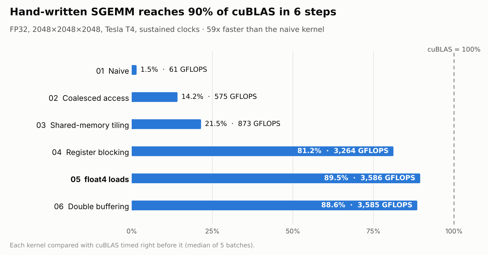

# CUDA & HPC Portfolio

Hands-on GPU performance engineering: CUDA kernel optimization measured against vendor libraries, LLM-relevant kernels exposed to PyTorch, and multi-GPU MPI + CUDA.

Each project starts from a simple, correct baseline and improves it one step at a time. Every step is verified against a reference, timed, and profiled with Nsight Compute or Nsight Systems, and the README for each project explains what changed and why it got faster.

## Projects

| # | Project | What it shows | Baseline | Status |
|---|---|---|---|---|
| 1 | [SGEMM optimization](01-sgemm/) | Memory hierarchy, tiling, register blocking, profiling | cuBLAS | Done (profiling pending) |
| 2 | [LLM kernels: Softmax & LayerNorm](02-llm-kernels/) | Warp-level reductions, kernel fusion, PyTorch C++/CUDA extension | PyTorch | Planned |
| 3 | [MPI + CUDA 2D Jacobi solver](03-mpi-jacobi/) | Multi-GPU domain decomposition, halo exchange, compute/communication overlap | CPU (OpenMP) | Planned |

## Results summary

Filled in as each project is benchmarked. All numbers list the GPU, CUDA version and problem size so they can be reproduced.

| Project | Best result | GPU |
|---|---|---|
| SGEMM (2048³, FP32) | ~90% of cuBLAS (6 steps; 59x over naive) | Tesla T4, CUDA 13.0 |
| Softmax / LayerNorm | TBD GB/s (TBD % of peak bandwidth) | TBD |
| Jacobi (2 GPUs) | TBD strong-scaling efficiency | TBD |

<picture>
  <source media="(prefers-color-scheme: dark)" srcset="01-sgemm/results/sgemm_steps_dark.png">
  
</picture>

## Build

Requires the CUDA Toolkit (12.x or newer), CMake 3.24+, and an NVIDIA GPU.

```bash
cmake -S . -B build -DCMAKE_CUDA_ARCHITECTURES=native
cmake --build build -j
./build/01-sgemm/sgemm_bench
```

Without `-DCMAKE_CUDA_ARCHITECTURES`, the build targets T4, A100, RTX 30xx and RTX 40xx (sm_75, 80, 86, 89).

## Repository layout

```text
common/          error checks, GPU timer, result verification
01-sgemm/        SGEMM kernels, benchmark, results
02-llm-kernels/  Softmax / LayerNorm kernels and PyTorch extension
03-mpi-jacobi/   CPU, single-GPU and MPI multi-GPU Jacobi solvers
```

## About me

HPC and GPU computing engineer. For the past three years I have supported researchers on a national supercomputer in South Korea, parallelizing and optimizing their codes with CUDA, MPI and OpenMP. All code in this repository is written independently for this portfolio.
